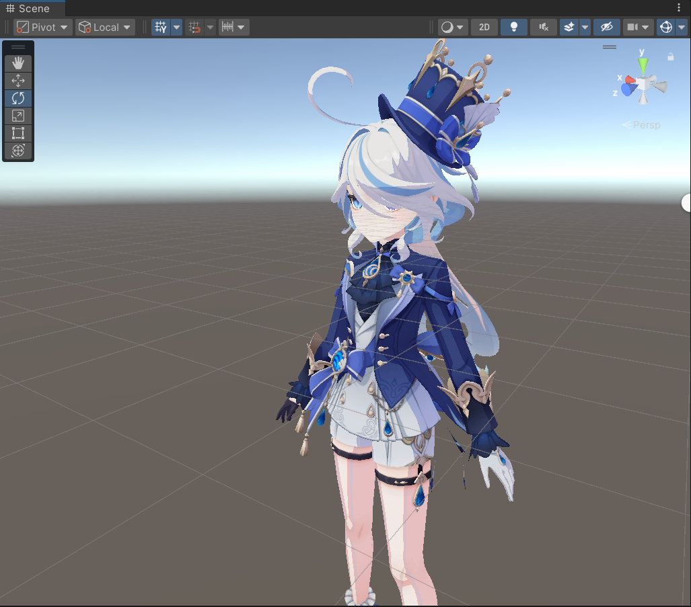
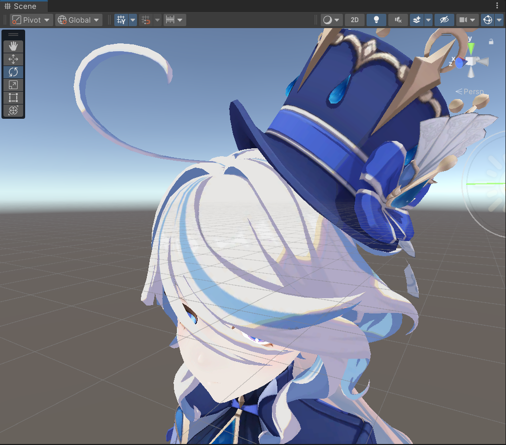
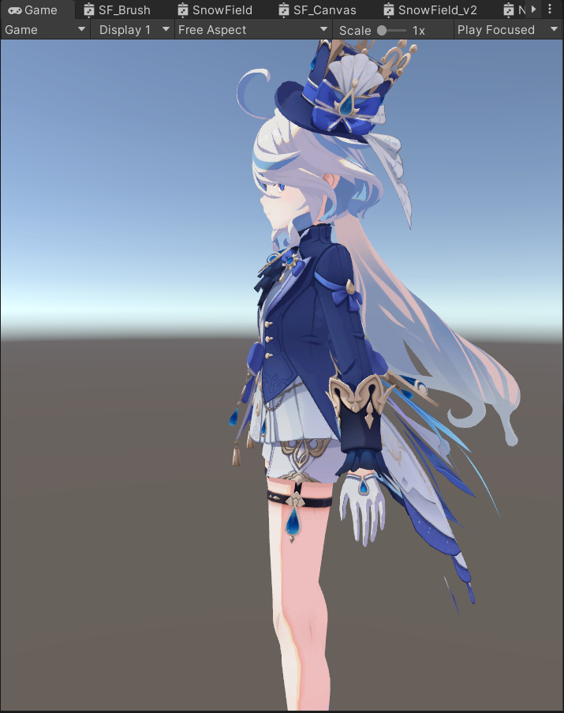
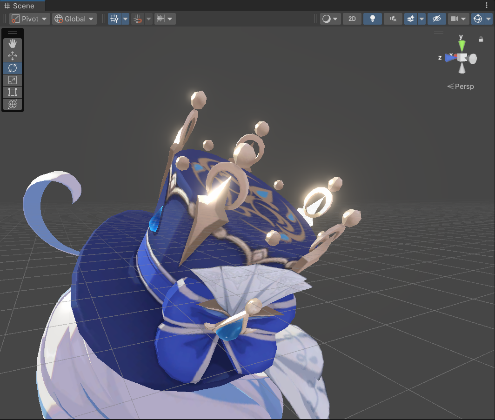
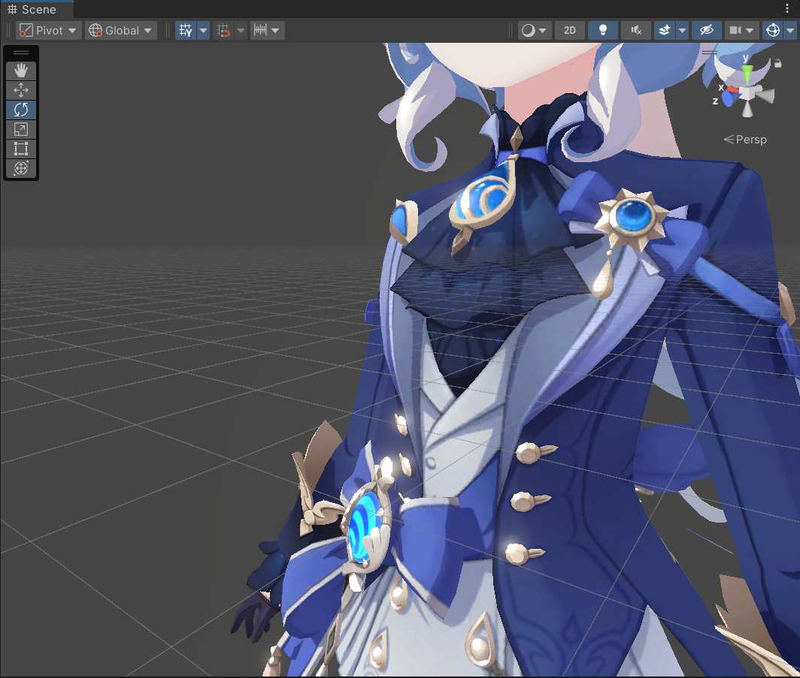
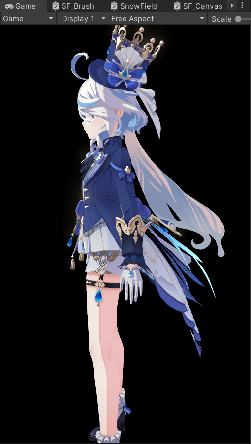
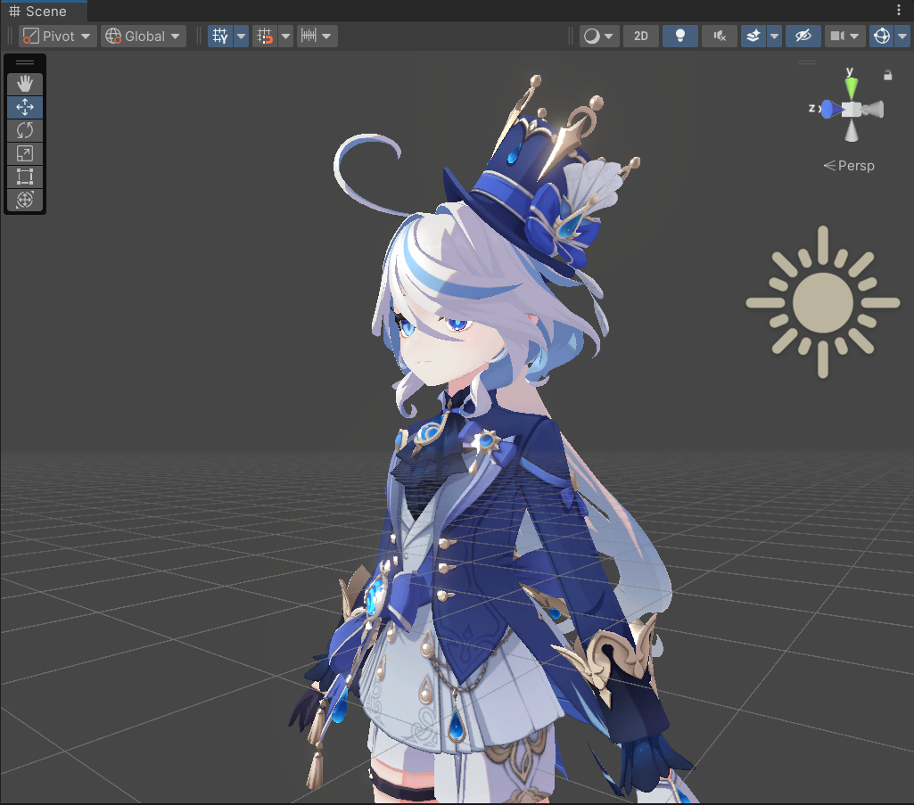
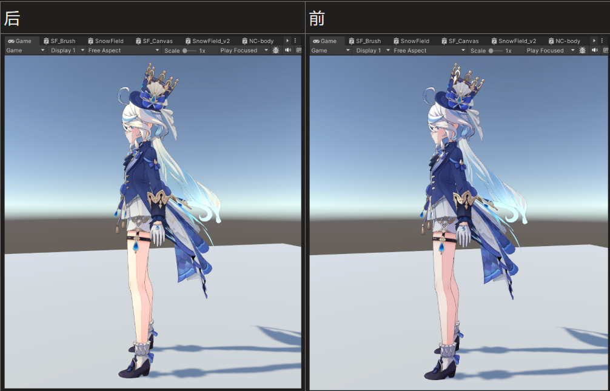

11.8

Furina：初始化

11.10

Furina：跑通了ramp阴影。存在一些问题

11.11

Furina：修复些许问题，优化了效果

11.13

基于渲染方程修改了着色流程  
	diffuse和specular分别计算  
	采样ramp中根据lightmap.b的高光度在diffuse和spec之间线性插值  
    AO应用于diffuse  

修改了高光逻辑  
NdotV根据lightmap.b添加0.1正偏移，用于pow之后的高光亮度溢出  
添加了bloom和自发光    
  
  
    
  

11.18

Furina：测试描边，调整效果

11.20

Furina：排查问题，多pass能正常运行。添加描边

11.21

Furina：添加光源颜色（主光 + 环境光）

  
  
